# CampusCare

### Campus Incident Reporting Mobile Application

CampusCare is a Flutter mobile application developed to simplify incident reporting and resolution tracking within the African Leadership University (ALU) community.

The application provides students with a centralized platform to report campus issues, attach photographic evidence, and monitor their resolution. Authorized campus staff can review incidents, update their statuses, and communicate progress through status notes.

Built with **Flutter, Dart, Firebase Authentication, Cloud Firestore, Cloudinary, and Cubit**.

> **Project status:** Functional academic prototype developed for the Mobile Application Development coursework at African Leadership University.

---

## Application Preview

### Student Experience

<p align="center">
  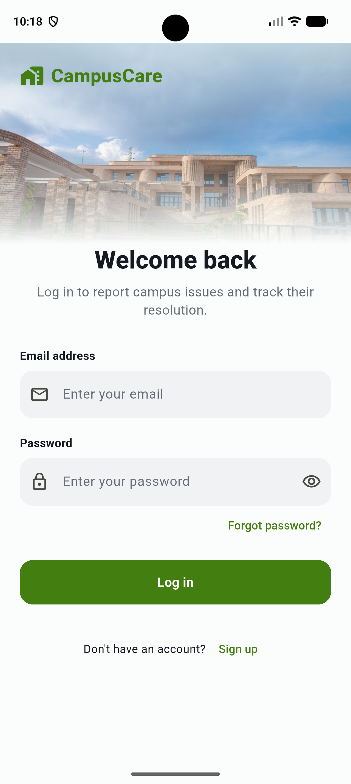
  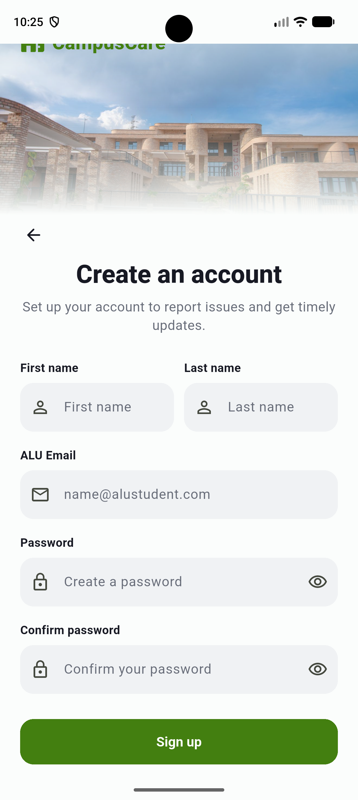
  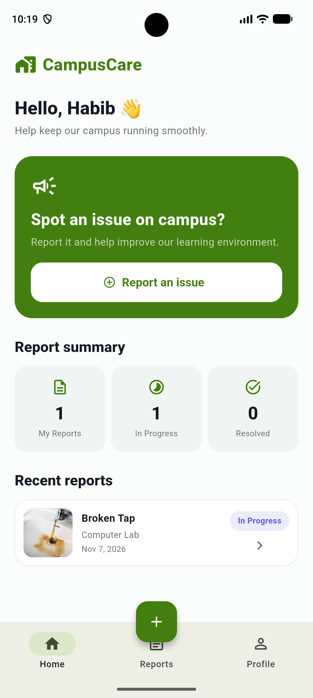
</p>

<p align="center">
  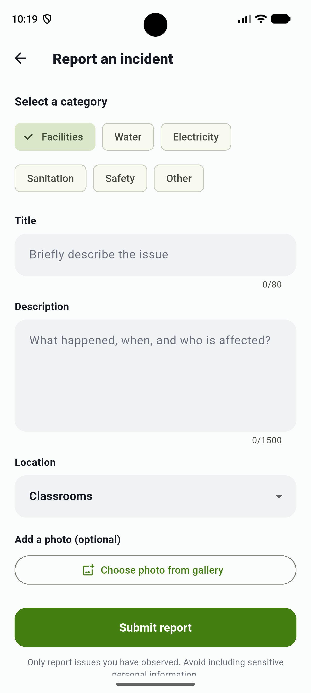
  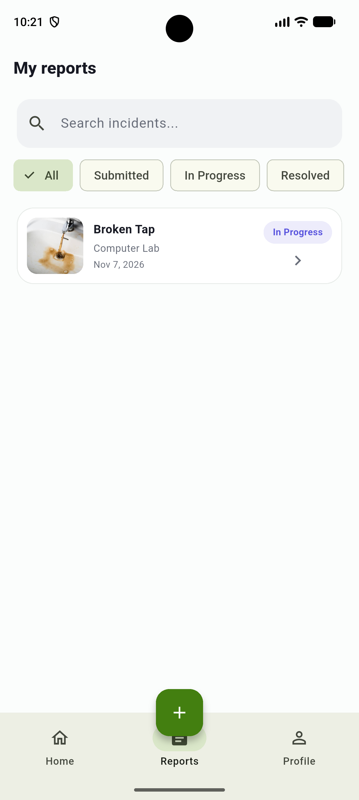
  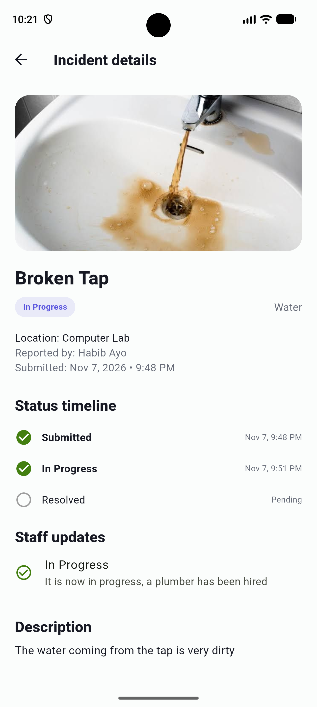
</p>

### Staff Experience

<p align="center">
  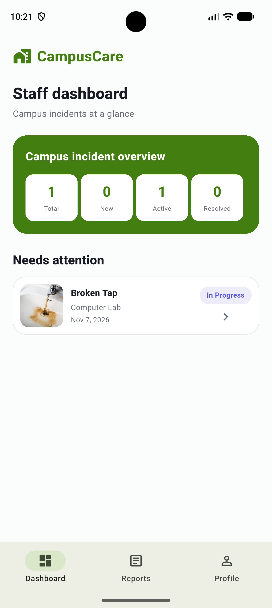
  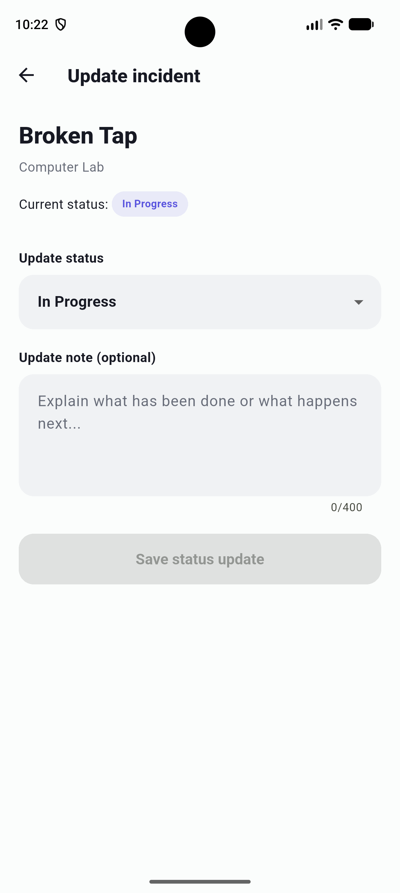
</p>

---

## Features

### Student Features

**Authentication and Account Management**
- Student registration using `@alustudent.com` email addresses.
- Secure login with Firebase Authentication.
- Email verification before application access.
- Password reset and logout functionality.
- Personalized student dashboard.

**Incident Reporting**
- Submit incidents with a title, description, category, and location.
- Select from Facilities, Water, Electricity, Sanitation, Safety, and Other.
- Attach an optional photograph from the device gallery.
- Upload photographic evidence to Cloudinary.
- Store incident information in Cloud Firestore.
- Receive form validation and submission feedback.

**Incident Tracking**
- View submitted incidents and their current statuses.
- Search incident records and filter by status.
- Access detailed incident information and photographs.
- Track progress using a three-stage status timeline.
- View staff updates and explanatory notes.
- Edit or delete eligible incidents while they remain Submitted.

### Staff Features

**Incident Management**
- Dedicated staff dashboard.
- Overview of total, new, active, and resolved incidents.
- View reported incidents and their details.
- Update incident statuses.
- Add notes explaining actions taken.
- Manage incident progress through Cloud Firestore.

Staff access is controlled through Firebase Authentication custom claims and Firestore Security Rules.

---

## Incident Lifecycle

CampusCare uses three incident statuses:

```text
Submitted
    |
    v
In Progress
    |
    v
Resolved
```

1. **Submitted:** The student reports an incident, and it is stored in Firestore.
2. **In Progress:** Authorized staff acknowledge the issue and begin addressing it.
3. **Resolved:** Staff mark the issue as resolved.

Students can monitor the status history and view updates from campus staff.

---

## Technology Stack

| Technology | Purpose |
|---|---|
| Flutter | Mobile application framework |
| Dart | Programming language |
| Firebase Authentication | User authentication and email verification |
| Cloud Firestore | User profiles, incident records, and status history |
| Cloudinary | Cloud storage and delivery of incident photographs |
| Flutter BLoC / Cubit | Application state management |
| Image Picker | Selecting photographs from the device gallery |
| HTTP | Cloudinary image upload integration |
| Git & GitHub | Version control |
| Android Emulator | Development and functional testing |

### Why Cloudinary?

Firebase Storage's billing requirements created a limitation for the project's free-tier development environment.

Following instructor approval to use an alternative cloud image storage provider, Cloudinary was integrated for photographic evidence.

Firebase Authentication and Cloud Firestore remain the application's authentication and database services.

---

## Application Architecture

CampusCare follows a **feature-based architecture** that separates presentation, state management, and data access.

```text
lib/
├── core/
│   ├── constants/
│   ├── theme/
│   └── widgets/
│
├── data/
│   ├── models/
│   └── repositories/
│
├── features/
│   ├── auth/
│   │   ├── cubit/
│   │   └── screens/
│   ├── home/
│   │   └── screens/
│   ├── incidents/
│   │   ├── cubit/
│   │   ├── screens/
│   │   └── widgets/
│   ├── staff/
│   │   └── screens/
│   └── profile/
│       └── screens/
│
├── shell/
├── firebase_options.dart
└── main.dart
```

### Architectural Layers

**Presentation Layer**

Flutter screens and reusable widgets are responsible for rendering the interface and handling user interactions.

**State Management Layer**

Cubits coordinate authentication states, incident data, loading indicators, errors, and UI updates.

**Data Layer**

Repositories encapsulate communication with Firebase Authentication, Cloud Firestore, and Cloudinary.

**Backend Services**

Firebase Authentication manages identity, Firestore manages persistent application data, and Cloudinary hosts photographic evidence.

This separation improves readability, maintainability, and component reuse.

---

## Database Structure

Cloud Firestore stores information in two main collections.

### Users

```text
users/
    {uid}/
        firstName
        lastName
        email
        createdAt
```

### Incidents

```text
incidents/
    {incidentId}/
        reporterId
        reporterName
        title
        description
        category
        location
        photoUrl
        status
        createdAt
        updatedAt
        statusHistory
```

Incident documents contain information submitted by students, while status history records staff updates.

The application subscribes to Firestore data streams so that relevant incident changes are reflected in the interface.

---

## Getting Started

### Prerequisites

Before running CampusCare, ensure that you have:

- Flutter SDK installed and configured.
- Dart SDK (included with Flutter).
- Android Studio or a supported Android emulator.
- Visual Studio Code or Android Studio.
- A Firebase project.
- A Cloudinary account.
- FlutterFire CLI configured.

### 1. Clone the Repository

```bash
git clone https://github.com/sultanhabibllah/campuscare.git

cd campuscare
```

### 2. Install Dependencies

```bash
flutter pub get
```

### 3. Configure Firebase

Create a Firebase project using the Firebase Console.

Enable:

- Firebase Authentication with Email/Password.
- Cloud Firestore.

Install the Firebase CLI and FlutterFire CLI if they are not already available.

```bash
dart pub global activate flutterfire_cli
```

Configure the application:

```bash
dart pub global run flutterfire_cli:flutterfire configure
```

Select your Firebase project and Android platform.

This generates or updates:

```text
lib/firebase_options.dart
```

Make sure the Firebase Android application is configured using the package identifier in your project.

### 4. Configure Firestore Security Rules

The project includes Firestore rules in:

```text
firebase/firestore.rules
```

Review the rules before deployment and publish them to the project's Firestore database.

The rules implement restrictions for authenticated students and authorized staff, including incident ownership and staff-only status management.

For a production deployment, further restrict incident read access according to privacy requirements.

### 5. Configure Cloudinary

Create a Cloudinary account and configure an **unsigned image upload preset**.

The project uses a Cloudinary configuration file:

```text
lib/core/constants/cloudinary_config.dart
```

Configure it with your own Cloudinary cloud name and unsigned preset name.

Example:

```dart
class CloudinaryConfig {
  static const String cloudName = 'YOUR_CLOUD_NAME';
  static const String uploadPreset = 'YOUR_UNSIGNED_PRESET';
}
```

Keep the existing class and constant names expected by the application if they differ from this example.

Cloudinary's upload endpoint follows this format:

```text
https://api.cloudinary.com/v1_1/YOUR_CLOUD_NAME/image/upload
```

The application sends an image using a multipart HTTP request and stores the returned `secure_url` in Firestore.

**Security note:** Unsigned upload presets are suitable for demonstrating the coursework workflow, but a production implementation should use authenticated uploads through a trusted backend.

Never place Cloudinary API secrets or Firebase Admin SDK private keys in the Flutter application.

### 6. Run the Application

Start an Android emulator and verify that Flutter detects it:

```bash
flutter devices
```

Launch CampusCare:

```bash
flutter run
```

You can also run the project directly through Visual Studio Code's Flutter debugging tools.

---

## Staff Account Configuration

Staff privileges are managed using Firebase Authentication custom claims.

A trusted administrator assigns:

```json
{
  "staff": true
}
```

to the authorized staff account using the Firebase Admin SDK.

The Flutter application reads this claim to determine which interface to display.

Firestore Security Rules must independently enforce staff-only permissions.

**Important:** Administrative scripts and Firebase service account keys must be stored outside the public repository. Never distribute private credentials or allow users to grant themselves staff privileges.

---

## Security Considerations

CampusCare includes:

- Firebase-managed authentication.
- Student email-domain validation.
- Email verification.
- Firebase custom claims for staff roles.
- Firestore Security Rules.
- Validation of incident submission fields.
- HTTPS communication with cloud services.

### Current Limitations

This is an academic prototype, not a production deployment.

- Incident read permissions should be narrowed for sensitive reports.
- Cloudinary's unsigned upload preset is not tied directly to Firebase identity.
- Secure cloud-image deletion is not fully implemented.
- Additional automated security-rule testing is recommended.
- Testing has primarily been conducted on an Android emulator.

These limitations and potential improvements are discussed in the technical report.

---

## Testing

CampusCare was developed and tested using Flutter, VS Code, and an Android emulator.

Testing and demonstration activities covered:

- Authentication and student registration.
- Form validation and navigation.
- Student dashboard and incident lists.
- Incident submission and Firestore persistence.
- Selecting photographs from the Android gallery.
- Cloudinary uploads.
- Search and status filtering.
- Incident details and timeline.
- Authorized staff dashboard access.
- Staff status updates.

Additional testing is recommended for production security, physical devices, multiple screen sizes, and automated widget/integration coverage.

---

## Cloud Integration Evidence

The following screenshots document the application's cloud service integrations.

### Firebase Authentication

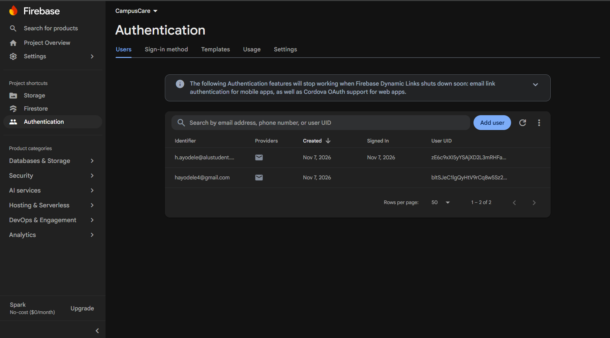

### Cloudinary Image Upload

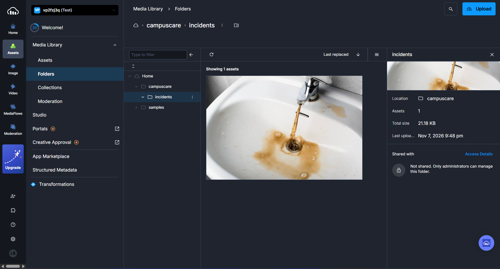

### Cloud Firestore

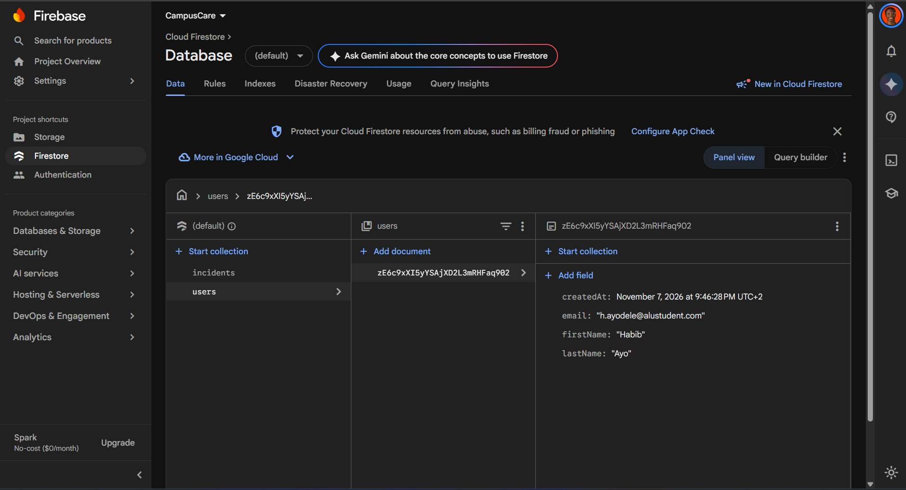

---

## Project Documentation

### Technical Report

The technical report covers the system architecture, application features, database design, state management, authentication, security, UI/UX decisions, testing, development challenges, and future improvements.

[View the CampusCare Technical Report](https://docs.google.com/document/d/1ymA9EUzVfyuLmSmLtJKzzUjvO3aRn1RsS5Wr67OdNlA/edit)

### Application Demonstration

A recorded demonstration showcases the application on an Android emulator, including the student reporting workflow, Firebase integration, and staff incident management.

[Watch the CampusCare Demonstration](https://drive.google.com/file/d/1iuVJGtgHHGMtdwgQzaPfcumDLcGSY3jA/view?usp=sharing)

---

## Future Improvements

Potential improvements include:

- Push notifications for incident updates.
- Department-based staff assignments.
- Incident prioritization and escalation.
- More granular access controls.
- Authenticated Cloudinary uploads and asset deletion.
- Expanded automated test coverage.
- Additional physical-device and iOS testing.
- Analytics for recurring campus infrastructure issues.

---

## Developer

**Habibllah Ayodele**

Software Engineering  
African Leadership University

GitHub: [sultanhabibllah](https://github.com/sultanhabibllah)
